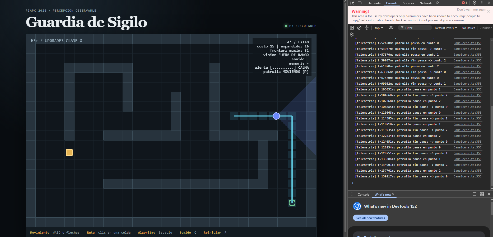

# Evidencia — Patrulla con pausas y mirada direccional

## Versiones
- Inicial: `d4de93e` (Initial commit del repo individual, creado desde la plantilla piapc-guardia-sigilo `ae98e1a`; árbol limpio).
- Final: commit que agrega esta evidencia (ver historial de `main`; código del upgrade sin cambios desde `b766f7a`).
- Entorno: Node v22.22.0, npm 10.8.2, Linux. Herramienta/modelo: Claude (Claude Opus 5.5) como agente, conducido y revisado por el estudiante. Ejecución y validación repetidas en Windows, Node v24.20.0.

## Validación de referencia (antes de cambiar)
`npm run validate` → exit 0 · 6 archivos de prueba / 39 tests · build OK (sólo advertencia de tamaño de chunk de Phaser, preexistente).

## Comandos y resultados
```bash
npm run typecheck          # tsc --noEmit
npx vitest run tests/behavior/patrol.test.ts tests/application/patrolRoute.test.ts
npm run validate           # typecheck + suite completa + build
```
- `npx vitest run tests/behavior/patrol.test.ts tests/application/patrolRoute.test.ts` → exit 0, todos pasan.
- `npm run validate` final → exit 0 · **10 archivos / 55 tests** · build OK.

## Registro breve
1. Exploración en lectura: `AGENTS.md`, `docs/arquitectura.md`, `GameScene.ts`, `perceptionSimulation.ts`, `memory.ts`, `pathFollower.ts`.
2. Contraste con el repo: (a) `src/domain/behavior/` no existía aunque la arquitectura lo prevé → se crea ahí; (b) `drawPerception` sólo usaba `vision.visible` para el color (confirmado en el código H3).
3. Spec redactada y revisada → plan aprobado → incrementos según `plan.md`, validando tras cada uno.
4. Corrección humana: se decidió que un clic desactive la patrulla (modo manual) para no perder la demo H3 de BFS/A*; la tecla P la reactiva. Se movieron los puntos desde la escena a `labLevel.ts` porque son datos de nivel, no presentación.

## Diff (cambios autorizados)
Ver `git show [HASH]`. Archivos tocados por este upgrade: los listados en `plan.md`. No se modificaron `src/domain/perception/`, `src/domain/navigation/` ni dependencias (`package.json` sin cambios).

## Matriz criterio → evidencia
| Criterio | Comprobación | Resultado |
|---|---|---|
| CA1 Los puntos se recorren en ciclo | `nextPatrolIndex` cicla; test `cycles patrol points` | ✅ PASA (ver salida) |
| CA2 Durante la pausa la mirada barre ±sweep | test `sweeps the gaze during a pause...` (π/4 a 250 ms y −π/4 a 750 ms) | ✅ PASA (ver salida) |
| CA3 Al terminar mira hacia la llegada y avanza de punto | test `ends the pause facing the arrival direction...` | ✅ PASA (ver salida) |
| CA4 Delta grande termina la pausa una sola vez | test `edge case: a single huge delta...` | ✅ PASA (ver salida) |
| CA5 Todos los tramos de patrulla son alcanzables | test `every consecutive patrol leg is reachable with A*` | ✅ PASA (ver salida) |
| CA6 Observable en ejecución | telemetría `patrulla pausa en punto N` / `patrulla fin pausa -> punto N` en consola + HUD `patrulla PAUSA/MOVIENDO` | ✅ PASA — logs arriba y `captura-patrulla.png` (HUD `patrulla MOVIENDO (P)`) |

## Reproducción visual / telemetría
Reproducción: `npm run dev` → `http://localhost:5173` → consola (F12). Validación local en Windows: `npm run validate` → 10 archivos / 55 tests, build OK (`docs/upgrades/validate-windows.log`).

```
[telemetria] t=839ms patrulla pausa en punto 0
[telemetria] t=2372ms patrulla fin pausa -> punto 1
[telemetria] t=6005ms patrulla pausa en punto 1
[telemetria] t=7522ms patrulla fin pausa -> punto 2
[telemetria] t=10305ms patrulla pausa en punto 2
[telemetria] t=11822ms patrulla fin pausa -> punto 0
...
[telemetria] t=67570ms patrulla pausa en punto 0
[telemetria] t=99052ms patrulla fin pausa -> punto 1      <- caso límite
[telemetria] t=103052ms patrulla pausa en punto 1
```
- **Caso normal:** pausa medida ≈1517 ms (839→2372, 6005→7522, 10305→11822): 1500 ms de spec + un cuadro. Ciclo 0→1→2→0 estable durante más de 2 min de ejecución.
- **Caso límite observado en ejecución real:** con la pestaña en segundo plano (t=67570→99052, ~31 s) llegó un `delta` grande; la pausa terminó **una sola vez** y avanzó al punto 1 sin saltear puntos (CA4 confirmado fuera de los tests).



## Revisión final
- Limitaciones: ver decisión arriba; parámetros calibrados a ojo.
- Riesgos: dependencia entre upgrades 02/04/05 y el medidor 03.
- **Decisión humana:** **Integrar.** Cumple CA1–CA6; el caso límite se verificó además en ejecución real.
