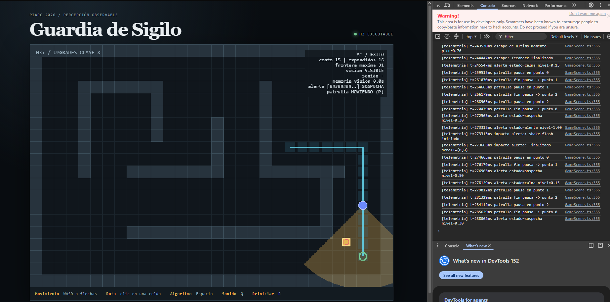

# Evidencia — Medidor de alerta y estados del nivel

## Versiones
- Inicial: `d4de93e` (Initial commit del repo individual, creado desde la plantilla piapc-guardia-sigilo `ae98e1a`; árbol limpio).
- Final: commit que agrega esta evidencia (ver historial de `main`; código del upgrade sin cambios desde `b766f7a`).
- Entorno: Node v22.22.0, npm 10.8.2, Linux. Herramienta/modelo: Claude (Claude Opus 5.5) como agente, conducido y revisado por el estudiante. Ejecución y validación repetidas en Windows, Node v24.20.0.

## Validación de referencia (antes de cambiar)
`npm run validate` → exit 0 · 6 archivos de prueba / 39 tests · build OK (sólo advertencia de tamaño de chunk de Phaser, preexistente).

## Comandos y resultados
```bash
npm run typecheck          # tsc --noEmit
npx vitest run tests/behavior/alert.test.ts
npm run validate           # typecheck + suite completa + build
```
- `npx vitest run tests/behavior/alert.test.ts` → exit 0, todos pasan.
- `npm run validate` final → exit 0 · **10 archivos / 55 tests** · build OK.

## Registro breve
1. Exploración en lectura: `AGENTS.md`, `docs/arquitectura.md`, `GameScene.ts`, `perceptionSimulation.ts`, `memory.ts`, `pathFollower.ts`.
2. Contraste con el repo: (a) `src/domain/behavior/` no existía aunque la arquitectura lo prevé → se crea ahí; (b) `drawPerception` sólo usaba `vision.visible` para el color (confirmado en el código H3).
3. Spec redactada y revisada → plan aprobado → incrementos según `plan.md`, validando tras cada uno.
4. Decisión humana: sólo la visión alimenta el medidor (el sonido queda fuera para respetar "visión tiene prioridad" y no adelantar H4.2). Los valores de configuración son de diseño y se calibraron en ejecución.

## Diff (cambios autorizados)
Ver `git show [HASH]`. Archivos tocados por este upgrade: los listados en `plan.md`. No se modificaron `src/domain/perception/`, `src/domain/navigation/` ni dependencias (`package.json` sin cambios).

## Matriz criterio → evidencia
| Criterio | Comprobación | Resultado |
|---|---|---|
| CA1 Sube visible, baja oculto | test `rises while the player is visible and falls when hidden` | ✅ PASA (ver salida) |
| CA2 Proximidad acelera | test `rises faster when the player is closer` | ✅ PASA (ver salida) |
| CA3 calma→sospecha→alerta con 2 cambios y 1 inicio | test `goes calma -> sospecha -> alerta...` | ✅ PASA (ver salida) |
| CA4 Histéresis de salida | test `uses hysteresis...` | ✅ PASA (ver salida) |
| CA5 Entradas inválidas rechazadas | test `rejects invalid input` | ✅ PASA (ver salida) |
| CA6 Observable | HUD `alerta [#####.....] SOSPECHA` + log `[telemetria] alerta estado=...` | ✅ PASA — logs y `captura-medidor.png` |

## Reproducción visual / telemetría
Reproducción: `npm run dev` → `http://localhost:5173` → consola (F12). Validación local en Windows: `npm run validate` → 10 archivos / 55 tests, build OK (`docs/upgrades/validate-windows.log`).

```
[telemetria] t=272563ms alerta estado=sospecha nivel=0.30
[telemetria] t=273313ms alerta estado=alerta nivel=1.00
[telemetria] t=276963ms alerta estado=sospecha nivel=0.50   <- histéresis: sale de alerta recién en 0.50
[telemetria] t=278129ms alerta estado=calma nivel=0.15      <- vuelve a calma en 0.15
```
- Los umbrales observados en ejecución coinciden exactamente con la spec (0,30 / 1,00 / 0,50 / 0,15).
- HUD en captura: `alerta [########..] SOSPECHA`.



## Revisión final
- Limitaciones: ver decisión arriba; parámetros calibrados a ojo.
- Riesgos: dependencia entre upgrades 02/04/05 y el medidor 03.
- **Decisión humana:** **Integrar.** Umbrales e histéresis verificados en tests y en ejecución.
