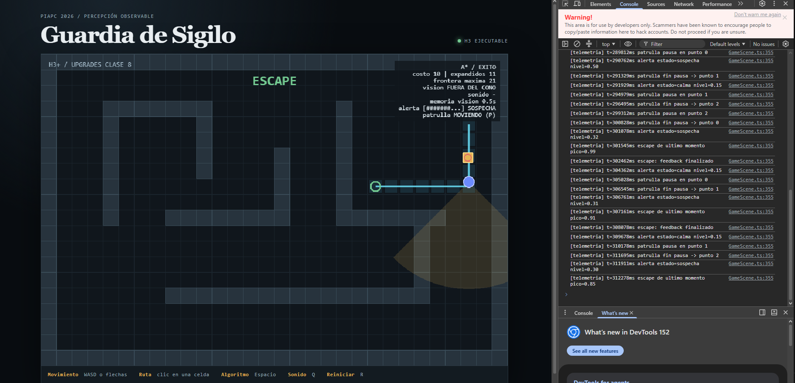

# Evidencia — Escape de último momento

## Versiones
- Inicial: `d4de93e` (Initial commit del repo individual, creado desde la plantilla piapc-guardia-sigilo `ae98e1a`; árbol limpio).
- Final: commit que agrega esta evidencia (ver historial de `main`; código del upgrade sin cambios desde `b766f7a`).
- Entorno: Node v22.22.0, npm 10.8.2, Linux. Herramienta/modelo: Claude (Claude Opus 5.5) como agente, conducido y revisado por el estudiante. Ejecución y validación repetidas en Windows, Node v24.20.0.

## Validación de referencia (antes de cambiar)
`npm run validate` → exit 0 · 6 archivos de prueba / 39 tests · build OK (sólo advertencia de tamaño de chunk de Phaser, preexistente).

## Comandos y resultados
```bash
npm run typecheck          # tsc --noEmit
npx vitest run tests/behavior/alert.test.ts
npm run validate           # typecheck + suite completa + build
```
- `npx vitest run tests/behavior/alert.test.ts` → exit 0, todos pasan.
- `npm run validate` final → exit 0 · **10 archivos / 55 tests** · build OK.

## Registro breve
1. Exploración en lectura: `AGENTS.md`, `docs/arquitectura.md`, `GameScene.ts`, `perceptionSimulation.ts`, `memory.ts`, `pathFollower.ts`.
2. Contraste con el repo: (a) `src/domain/behavior/` no existía aunque la arquitectura lo prevé → se crea ahí; (b) `drawPerception` sólo usaba `vision.visible` para el color (confirmado en el código H3).
3. Spec redactada y revisada → plan aprobado → incrementos según `plan.md`, validando tras cada uno.
4. Decisión humana: umbral 0,75 elegido en ejecución para que el escape sea raro y significativo. Limitación: un parpadeo de visibilidad en el borde del cono por encima del umbral cuenta como escape.

## Diff (cambios autorizados)
Ver `git show [HASH]`. Archivos tocados por este upgrade: los listados en `plan.md`. No se modificaron `src/domain/perception/`, `src/domain/navigation/` ni dependencias (`package.json` sin cambios).

## Matriz criterio → evidencia
| Criterio | Comprobación | Resultado |
|---|---|---|
| CA1 Escape tras casi-detección | test `emits escape when vision is lost after a near miss` | ✅ PASA (ver salida) |
| CA2 Sin escape en exposición breve ni tras alerta | test `edge case: no escape for a short exposure or after full alert` | ✅ PASA (ver salida) |
| CA3 Feedback termina | log `escape: feedback finalizado` ~900 ms después | ✅ PASA — `escape: feedback finalizado` ≈917 ms después de cada escape |

## Reproducción visual / telemetría
Reproducción: `npm run dev` → `http://localhost:5173` → consola (F12). Validación local en Windows: `npm run validate` → 10 archivos / 55 tests, build OK (`docs/upgrades/validate-windows.log`).

```
[telemetria] t=243530ms escape de ultimo momento pico=0.76
[telemetria] t=244447ms escape: feedback finalizado
[telemetria] t=301545ms escape de ultimo momento pico=0.99
[telemetria] t=302462ms escape: feedback finalizado
[telemetria] t=307161ms escape de ultimo momento pico=0.91
[telemetria] t=308078ms escape: feedback finalizado
[telemetria] t=312278ms escape de ultimo momento pico=0.85
```
- Todos los escapes registrados tienen pico ≥ 0,75 (umbral de la spec) y ninguno ocurrió después de llegar a ALERTA.
- El feedback termina ≈917 ms después (900 ms de spec + un cuadro).
- Captura `captura-escape.png`: texto **ESCAPE** en verde con `vision FUERA DEL CONO`.
- Exposiciones breves (p. ej. `t=288062ms sospecha nivel=0.30` seguida de calma) no generaron escape.



## Revisión final
- Limitaciones: ver decisión arriba; parámetros calibrados a ojo.
- Riesgos: dependencia entre upgrades 02/04/05 y el medidor 03.
- **Decisión humana:** **Integrar con observación.** Funciona según spec; queda como riesgo que el parpadeo en el borde del cono cuente como escape.
